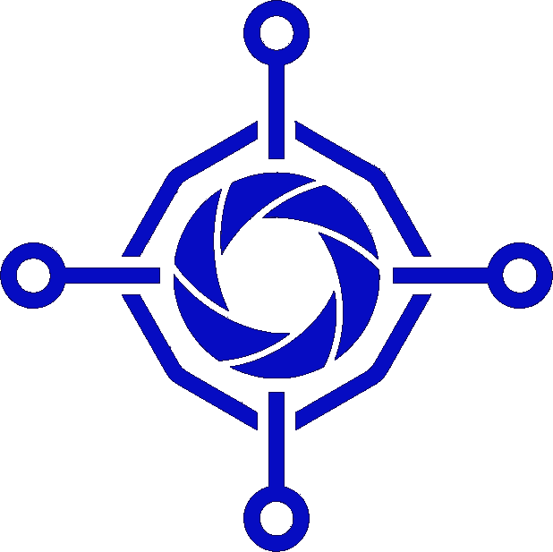

  

# 🌐 Universal Agents (beta)

Current public version: **0.9.10** · Licensed under the [Apache License 2.0](LICENSE).

## 🧱 Chapter 1: The Foundation

Hi, you’ve found Universal Agents (UA). What are they? Well, they are whatever you want them to be. This repo contains a fully functioning framework that is designed for scale first. However, as an *initial demonstrator*, the repo includes a personal assistant implementation that functions akin to OpenClaw or Hermes.

**But…** under the hood, it’s built different!  When thinking agents, we imagine industrial swarms that are big… massive… potentially planetscale.  Thus, the key motivation is an architecture that scales with the task. For example, when you spin up your personal assistant (from this repo), you get a team that works on your behalf. For bigger tasks you get multiple teams that interact with each other etc.

Some notable features:

- 🧩 **Highly Modular Architecture:** From the gateway, to the message broker, to the database, to the memory store, to the agents themselves - everything is distributed. Each component is independently scalable (without impacting the others) and thus you can adjust the impedance of the swarm to fit your network topology and workload. Run agents on your personal computer, on edge or in a cloud data center. Create multiple teams (human + agent) that work together. *It’s all possible.*
- 🔐 **Proper Agent / Environment Segmentation And Brokered User Interactions:** The intelligence layer should make
decisions, but durable routing, memory, credentials, user delivery, and operational recovery must be owned by deterministic runtime components. For example: your agents should never directly handle your personal / corporate sensitive info. A purpose-built small efficient encrypted credentials store runs parallel to the framework (you can also substitute 3rd party credential stores such as Bitwarden and Keepass) and is only accessible via a deterministic broker process. When the framework needs to collect new credentials, the agent executes brokered tool calls that collect the information via a firewalled interface. When the agent subsequently needs to use those credentials (e.g. in an API), it crafts the API call and instructs the broker to hydrate the call with proper values from the credentials store.
- 👥 **Scalable Hierarchical Design:** You team scales with the task. You talk to the team lead. The team lead then decides how to proceed. For simple tasks it will perform the job itself but for complex tasks it will build out a plan and a team to execute. Team lead will spin up necessary specialist agents to do the work, track to the plan, then spin the specialists down when the job is complete. When the work changes, the Team Lead can craft new agent class definitions to fit the objective.
- 🛠️ **Agentic Internal Improvement loops:** While you sleep the team works. Periodically, dedicated agents spawn to review previous interactions and extract important context for later use. They can collect facts from previous interactions or organize / collate knowledge that's been captured previously.
- 💬 **Intelligent Conversation Handling:** Your conversation threads are constantly groomed to only retain (and recall) useful information. Every turn applies compaction and memory recall / hydration to ensure that the context window only carries what the agent needs.
- 🧠 **Multiple Dedicated Memory Processes:** Memory (context) is everything. UA contains *five* separate memory mechanisms dedicated to preserve different types of information. *Conversation history* keeps each thread and recalls what matters from it, *user memory* builds out a profile of each user, *team memory* stores important information for the team’s operation, a purpose-built *graph database* retains important relationships and supports context-driven retrieval, and the *knowledge base* holds the how-tos, decisions, lessons and references that people and agents write together.
- 👤 **Multi-User Support:** While still in testing stage, multiple (human) users can separately interact with the team. Each user has their own credentials and memory spaces. The same agentic team can seamlessly multitask on multiple requests from different users at the same time without crossing permissions boundaries.
- 📦 **Smart Context Offloading:** Some tools can produce undesired amounts of junk output (e.g. fetching a JavaScript-heavy website), so deterministic processes write large or binary results to task-scoped artifacts instead of directly populating context. The agent sees a compact summary and uses bounded artifact-inspection actions to retrieve only relevant pieces, mitigating context-window pressure.
- 📡 **Observability:** All agent communication happens via a tiny efficient messaging broker thus making it publicly observable. If something isn’t going right, you can see the exact agent / team interactions and debug issues. More importantly, you can have 3rd party tools / agents observe swarm behavior and flag suspicious activity.
- 🛡️ **Deterministic Authorization:** An industrial-grade, deny-by-default framework built on Cedar ([the access control framework powering AWS](https://aws.amazon.com/about-aws/whats-new/2023/05/cedar-open-source-language-access-control/)) checks every agent operation. Every tool, shell command, MCP operation, and broker action has an access level (read, write, or full), and each call is checked against the access of both the agent and the person it works for. When an agent lacks access, its request waits in your Inbox and its task pauses. The request is announced once, in the conversation where you can decide it or otherwise in your default delivery chat; Telegram and Discord add decision buttons. Blocks stop an agent's access at once.
- 🔎 **Approval-Driven Agent Actions:** Agents ask for the access they need and stage exact platform changes, e.g. installing a skill from a public repo, for a person to approve. Installation invokes a mixture of deterministic processes (e.g. NVIDIA SkillSpector) and intelligent actions that enforce strict boundaries on execution.
- 🕸️ **Build Your Own Team Topology:** Every agent is an independent entity tied to the team through a deterministic team identity. Create full teams with special communication rules or independent agents that freely talk to each other. (wip)
- ♻️ **Long Horizon Work:** Often, working toward a goal may take days, weeks, months or even years rather than a few turns. That means that the team must be able to devise and track hierarchical plans with work that might happen periodically or opportunistically with pauses or gaps in between. Jobs are assigned by agent type, tracked by objective and persisted to database so that the work can resume when appropriate and can survive long periods of inactivity or abrupt adverse events (such as agent or system crashes).
- ⚙️ **Deterministic Code Execution:** Agents can promote Python or single-file Rust into immutable revisions, run them once or on interval/cron schedules, and manage restart-surviving Kubernetes services. SSH uses pinned, brokered PTY sessions instead of exposing keys or arbitrary connection targets.
- 🔌 **Broad Provider Support:** Broad provider support: Connect any OpenAI API compatible provider, use your OpenAI codex subscription or connect to XAI via oauth to power your team.

## 🤝 Chapter 2: Your Personal Assistant (Team)

Best way to get started with UA is to take your own personal agentic team for a spin. While you can run UA directly on your machine, a better option is to run it in a Docker container (for safety, ease of maintenance and upgrades). See [QUICKSTART.md](QUICKSTART.md) for step-by-step launch and onboarding instructions, or see [BUILD_README.md](BUILD_README.md) to build from scratch.

Features:

- 🧑‍💼 Your personal agentic team
- 👥 Multi-user support
- ⚙️ Immutable Python/Rust jobs, recurring schedules, MCP hosting, and brokered SSH
- 🔐 Integrated encrypted credentials store
- 🤖 OpenAI API, OpenAI Codex and xAI Oauth support
- 🎙️ Voice input / output support
- 🗺️ Custom-generated articles, comparisons, how-to sites, and interactive apps
- 📲 Integration with Telegram, WhatsApp, Discord, Signal CLI, iMessage, and Web Chat
- 🛡️ Fully integrated permissions boundaries for agent actions
- ♻️ Internal self-improvement loops
- 🔄 On-the-fly model profiles with provider/model selection, reasoning and context controls and automatic failover switches

### Onboarding

Onboarding can be done in a few different ways. For best user experience, we recommend using the web UI that walks you through step-by-step configuration. **Note:** At the end of onboarding, you will be given an opportunity to save your configuration files `config.yaml` and `team.env` - please make sure to do so. The full config contains hundreds of parameters (with sensible defaults). Once you are comfortable with your initial team, feel free to dig into the configuration and play around with the knobs.

If you are an advanced user, you can also run an onboarding script in non-interactive mode. Make sure to change / pre-populate the `config.example.yaml` and a `team.example.env`. FYI - if you are running in a docker environment all values in the `.env` file can be supplied via docker secrets and the `.env` file can be discarded.

### Web UI

The Web UI is designed to be lightweight so don't expect it to have all the bells and whistles of a full-fledged chat app. However, it is being built out as we see need for more functionality so you will see new things pop up all the time.

### Custom Website Generation

In terms of usability, Markdown is downright awkward. For ease of use, Universal Agents can generate browser-ready articles, side-by-side comparisons, procedural how-to pages, and interactive apps with browser-local progress tracking. Ask for the format that fits the content—for example, a car comparison, a repair walkthrough, or a workout tracker. Generated sites are automatically saved and can be revisited at any time. Each page also has a quick chat interface for follow-up questions.

## 🧠 Chapter 3: The Intelligence Stack

Loop engineering was dead on arrival. It’s the wrong approach because it attempts to handle the task in a single (perhaps nested) loop. Team engineering is the way forward. Intelligence needs an operating stack with graduated capabilities. Highly intelligent team managers break down tasks into trackable actionable plans. Specialist agents handle the assignments via their own internal loops. If a specialist fails multiple times, it bumps the failure back up the intelligence stack so that higher-order thinkers can examine the output and alter the course of action.

We feel that a solid foundation has been laid with Universal Agents. The next step is to build on top of it layers of intelligence that create more complex operational patterns. Feel free to experiment with topologies that create specialists, teams and entire organizations.

## 🚀 Chapter 4: The Future (and you!)

*“The future is not what it used to be.”* - Yogi Berra

UA is just getting started on a long journey. Our goal is to make this framework widely accessible and scalable to incorporate any task you can imagine applying intelligence to. Since personal assistants became prominent, we figured it’s as good a beginning as any for a first public release. But now the road splits into many paths. We will explore them together, to bring UA to as many people and organizations as we can.

## 🧭 Other Info

### 📚 Accessing Documentation

Once the container is up and running:

- 🌐 **Web Browser**: Once your team is up and running, access the full built-in documentation site at [http://127.0.0.1:18090/docs/](http://127.0.0.1:18090/docs/) (or another public URL, if you configured it during onboarding).
- 💬 **In-Chat Command**: Type `/docs` in any active chat interface (Web Chat, Telegram, Discord, Signal, Photon/iMessage, WhatsApp) to get a direct link to the documentation home page.
- 👥 **Web Chat Onboarding**: To onboard a new user, an authenticated admin can run `/user invite --new "Bob" --label "Onboarding"` directly in Web Chat. See [Multi-User Onboarding](user_docs_source/newuser/index.md) for browser-safe commands and external-platform identity linking.
